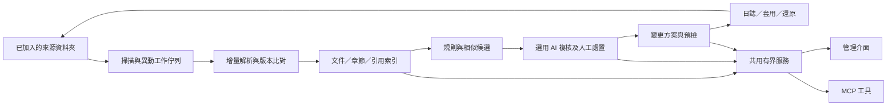

# MD 管理台 v2 企畫書

## M-00｜目的與產品定位

將目前「文件列表＋規則提示」升級成能處理大量文件的整理工作區：新增/變更自動入列、分析有依據、建議可追蹤、合併保留獨有內容、修改/移動/刪除可預檢與復原。

整理品質與執行速度分開衡量。更快列出一千條候選，不代表整理更準確；相似、完成或長時間未讀都不是自動刪除理由。保留 v0.1 的資料夾、授權來源、版本衝突及旁註保護。

本文件保留完整升級企畫；離線 UI 示意已由正式工作台取代。[現況證據 M-01～M-14](references/baseline-and-sources.md#b-03md-管理台的實際缺口) 是程式分析；尚未量測現機效能。

## M-01｜優先處理的現況不足

| 類別 | 目前問題 | 使用者會遇到什麼 | v2 決策 |
|---|---|---|---|
| 正確性 | 掃描失敗與不存在都可能移出索引 | 暫時讀不到的文件看起來消失 | 明列 unreadable/unknown/deleted，保留上次索引 |
| 範圍 | 文件只有單一 rootId | 父子範圍掃描後歸屬改變 | 穩定文件 ID＋多對多範圍關係 |
| 狀態 | 自動完成、人工標註與篩選不同步 | 已完成數量與列表不一致 | 共用 effective-state resolver |
| 讀取負載 | JSON 全類載入、health 跑 audit、state 重複取數 | 索引增大後簡單畫面也變慢 | 正規化索引、常數 health、按頁 API |
| 索引 | 每次讀/解析所有 MD | 新增一份也要等全庫掃描 | 增量佇列、監看、可取消工作與快取 |
| 整理品質 | 固定句型、長度門檻、精確重複 | 誤報難消除，語意重疊抓不到 | 規則＋相似候選＋有證據 AI 複核 |
| 合併 | 只能選當頁；人工貼整段 | 來源遺漏、反例被覆蓋，取消後留標註 | 跨頁選取、保留矩陣、依賴式變更方案 |
| 復原 | 部分補償失敗缺完整修復入口 | 不易判斷哪些操作已套用 | durable journal＋逐項狀態與修復頁 |
| UI | 全畫面重建、草稿不穩定、沒有工作進度 | 操作被刷新打斷、等待無法判斷 | 局部更新、草稿、工作中心與列表虛擬化 |

## M-02｜資訊與服務架構



原始 MD 仍為檔案權威來源；索引可重建，人工決策與歷史不可因重掃而刪除。文件全文、列表中繼資料及分析結果分開存取。結構、狀態與變更協定見 [共用契約](references/contracts.md)。

## M-03｜全面提升掃描與索引

### 增量流程

1. 初次索引：async 目錄列舉，有限併發讀取，以 worker 處理較重的 AST/指紋計算，主事件迴圈保留 UI/MCP 回應。
2. 一般暖掃描：先比較檔案識別、mtime、size；未變更不重讀/重解析。不同步時間或不可信檔案系統可要求完整 hash 模式。
3. 監看：事件只把路徑標 dirty，去抖、合併連續事件。監看啟用時明示範圍；宿主/服務未運行期間不宣稱持續監看。
4. 解析：內容 hash 改變才更新正文及章節；parse cache key 為 raw hash＋parser version，規則快取再加 ruleset version。
5. 對帳：週期/啟動時做 metadata reconciliation，處理漏事件；可排程完整 hash 校驗。未變 mtime/size 不保證位元組未改，破壞性操作必做 live hash。
6. 狀態：scan 有 queued/running/cancelled/partial/failed/completed。只有成功列舉的子樹才可判定缺檔；權限/讀取失敗保留舊內容及索引時間並標 unreadable。

工作顯示目前階段、已處理檔案/bytes、錯誤與取消/重試。總量未知時顯示不定進度，不捏造完成百分比。無變更的一般暖掃描目標為 0 份正文重讀與重解析；完整校驗不套用此目標。

### 範圍、別名與移動

文件與 scope_memberships 分離；父子範圍只索引一次，保留各視圖歸屬。移除範圍僅移除關聯，仍由其他範圍持有的文件不消失。確定不再被任何範圍管理的紀錄可封存，歷史保留。

用 realpath、Windows 大小寫規則、junction/symlink 及實體檔案識別維持現有邊界。rename/move 在同服務操作時保留文件 ID；外部移動只在證據足夠且匹配唯一時延續，否則列待對應，不把相同 hash 的兩個副本合成同一文件。

## M-04｜搜尋、引用與列表效能

- 文件列表只讀需要的欄位，以 SQL 索引/JOIN/cursor 篩選；移除先載全文再丟掉正文與逐文件 N+1 查詢。
- 以標題、路徑、章節及正文建立 FTS5；英文識別字、繁體中文切詞、二字/短詞各有測試集。trigram 不等於完善中文斷詞，短查詢採有範圍的 fallback，禁止退回全庫全文暴掃。
- MCP 先回摘要/章節位置，再以 ID 詳讀；UI 每頁 50 筆，虛擬視窗約 100–200 列，跨頁選取以選取集或「篩選 snapshot＋排除 ID」表示。
- 引用圖記錄來源 revision/span 與目標文件/anchor，只重建改動來源的邊。支援 Markdown link/reference/image，分期加入 repo-root、Wiki-link、HTML href；不能解析的語法顯示 coverage gap。
- 刪除/移動前先更新 dirty queue、確認範圍列舉新鮮度與引用圖完整度，再核對有關來源及目標 live hash。引用索引不新鮮時暫停破壞性操作，不以快取代替核對。
- 未加入範圍、外部網站、應用私有語法不在保證內。單純改文案只檢查新增/變更的邊，不逐份重讀全庫。

SQLite 可提供 FTS5、排名及多種 tokenizer，中文處理與部署能力需另外測試。[SQLite FTS5](https://www.sqlite.org/fts5.html)

## M-05｜五項原則的整理判斷升級

採三級：**確定性檢查 → 相似候選 → 按需語意審核**。每一層標示判斷來源、證據位置與未解問題；沒有模型服務時，前兩層仍可使用。

| 原則 | 自動候選 | AI 複核內容 | 建議產物 |
|---|---|---|---|
| description 做什麼/何時用 | 缺欄位、格式、過長/觸發詞不足 | 能力、時機、邊界是否清楚；是否吸引不相關任務 | 保留必要邊界的縮短版本及理由 |
| 多流程拆路由與 references | 標題/長度/方法群組 | 確認實際獨立流程、共用內容與使用頻率 | 入口路由＋應移段落/附件路徑＋引用修復 |
| 固定先讀/每次跑測試 | AST 中指令句與限定詞 | 是必要不變條件、責任索引，還是無關重複工作 | 文件責任對照與依變更選測的替代條文 |
| 先問再做 | 批准/詢問句型候選 | 哪些已有授權，哪些涉及範圍、不可逆或外部行為 | 動作、對象、前提、範圍、停止條件的明確授權 |
| 重疊或矛盾 | raw/normalized hash、章節指紋、近似群組 | 是否同作用域/版本/用途；是互補、重複或真正矛盾 | 合併/保留/拆分決策與逐項依據 |

長度門檻可配置，僅作提示，不因超過 180 行就強制拆分。程式碼例子、引文、否定句及歷史說明要能區分，避免句型誤報。AGENTS/skill 使用其原生作用域，不能把全專案一般文件都當成 AI 指令。

新 finding 包含 rule ID/version、來源 hash、行/段落、原文、候選理由、建議替代、影響文件、判斷來源。使用者可採用、忽略、延後、解決；來源改變則 stale。忽略規則可綁檔案/段落/版本/期限，不能變成整庫永久靜默。

近似候選先用章節指紋/倒排索引縮小配對，避免 N² 全文件比對；語意審核只處理選中群組與必要片段。向量為可選後續能力。每次審核設定範圍、內容量及耗用上限；沒有原文證據就列待查，不自動改寫。

## M-06｜編輯、整合、移動與標記

**段落編輯**：以 section ID/source revision 提案 patch，顯示局部差異與上下文；套用前核對 span/hash。保留 BOM、換行及未變區域。找不到原段落則衝突，不模糊替換另一處相似文字。

**合併工作區**：跨頁選來源 → 依用途/版本分組 → 產生「原段落→目標段落」保留矩陣 → 處理矛盾 → 選唯一維護位置/拆附件 → 更新引用 → 預覽及預檢。獨有內容可保留、移入附件或經明確理由捨棄；未處理項阻止合併完成。來源超出單次預算時分群，不能為了省篇幅無聲丟內容。

**改名/移動**：原生 move operation，保留文件 ID並預覽相對連結改寫；跨 scope 必須兩側授權，跨磁碟按 copy/verify/trash 記錄，不能假設 rename 原子性。

**標記與分類**：完成程度、用途是否過時、取代關係、待刪除、確認依據分開；批次改分類/標籤有預覽與版本條件。一般旁註不修改原文；可攜匯出或將 metadata 寫回 MD 為明確選項，不為每檔預設生成副本。

合併後的待刪標記與成果寫入使用依賴式方案：只有相應操作成功才生效。提案取消不留下提前寫入的標註。寫入失敗與部分完成均需可定位、可重試，不顯示整批成功。

## M-07｜刪除、回收及修復

一般流程：**候選標記 → 完成/取代依據 → 引用與用途核對 → 批次預檢 → 移入回收區 → 可還原**。

- 不以檔齡、檔名含 old、使用率低、全部勾選或完全重複直接刪除。授權/上游受管文件維持建議模式。
- 刪除前顯示來源版本、理由、替代文件、引用覆蓋與例外。既有明確授權涵蓋同批次即可執行，不逐檔反覆詢問。
- 回收區保留原始 bytes、路徑、旁註與方案；預設建議保留 30 天，但不自動永久清除。永久清除需獨立動作或明確設定的政策。
- 不保證所有外部系統引用；預檢明列哪些範圍已更新、哪些不可讀、哪些語法未支援。覆蓋不明時限制範圍或停止刪除。
- journal 逐項記錄 planned/backup_ready/written/verified/indexed；進程中斷後以真實 hash 對帳，支援 recovery_required 修復入口。
- 還原遇到後續新修改，提供差異與新方案；保留雙方，不覆蓋。

檔案與 DB 的補償、冪等與並行限制依 [C-06～C-08](references/contracts.md)。這是可追溯的批次復原，不宣稱多檔案具備完全原子交易。

## M-08｜UI 重新設計

### 導航與畫面構成

以三種布局作取捨：卡片儀表板易展示但不利大量整理；檔案樹適合定位但不利跨資料夾審核；**列表＋詳情＋獨立比較工作區**最適合本任務，採為推薦方向。正式介面採單一布局；2.0.1 已移除聚焦/精簡密度切換。

```text
頂列：目前專案/範圍   全域搜尋   索引新鮮度/背景工作
左欄：本次變更、全部文件、待核對、待刪除、變更批次、回收區
      範圍樹及保存視圖（重複群組、引用問題、受保護）
中欄：文件/群組列表，篩選、跨頁勾選及批次動作列
右欄：原文/章節、標註依據、入站引用、來源版本與歷史
比較頁：保留矩陣 → 衝突決策 → 合併差異 → 預檢 → 套用
```

首頁預設顯示「本次新增、變更、待核對」，不以全庫統計卡占滿第一屏。頂列常駐當前 scope，所有批次動作顯示影響筆數與篩選範圍；不可讀/過期/需修復突出可採取的行動。

### 五個主要使用旅程

| 旅程 | 最短操作 | 必須看見的回饋 |
|---|---|---|
| 加入新 MD | 已加入範圍存檔 → 監看或手動增量掃描 | 新增列、分類依據、索引時間；無掃描服務時明示 |
| 處理整理建議 | 開待核對 → 群組 → 原文/建議 → 採用或忽略 | 規則候選/AI複核/人工確認可辨識 |
| 批次待刪 | 勾選 → 標記理由 → 檢查引用 → 預覽批次 | 誰會被影響、哪些仍需處理、可還原位置 |
| 整合文件 | 來源集 → 保留矩陣 → 處理矛盾 → 差異 | 每份來源的獨有內容有去向，無未解衝突 |
| 衝突/中斷恢復 | 工作中心 → 問題項 → 比較/重試/還原 | 已完成/未完成/需人工修復逐項清楚 |

### 互動與可及性規格

- ≥1200px：左欄 216–240px、列表/詳情可調；768–1199px：左欄可收合、詳情抽屜；<768px：單欄逐層進入並保留返回狀態。
- 列表可調密度、欄位與排序；長路徑折行/省略但可複製。內容區可水平閱讀程式碼，不讓整頁橫向溢出。
- 搜尋 debounce＋abort/request revision，舊請求不覆蓋新結果。局部更新保留焦點、選取與捲動；草稿按 document revision 保存，切換目標先保留未存內容。
- 差異頁用逐行/段落與操作摘要，完整原文按需展開；不要每個批次預設載入全部前後文。
- 鍵盤可完成搜尋、選取、開啟、關閉及批次操作；dialog 限定焦點並返回觸發處。狀態不能只靠顏色；提供亮/暗模式、縮放及錯誤文字。
- 桌面控制遵守 WCAG 2.2 目標尺寸/間距要求；主要觸控操作採 ≥44px 的產品目標。[W3C 說明](https://www.w3.org/WAI/WCAG22/Understanding/target-size-minimum.html)

離線 UI 示意已由正式工作台取代；現行操作以[使用說明](../../README.md)與[實作進度](../../實作進度.md)為準。

## M-09｜可量測效能與品質驗收

下列都是**待驗證的設計目標**。先在固定 CPU/SSD/記憶體/OS/Node 版本建立 v0.1 基線，記錄冷/暖狀態；以 1k、10k、100k 文件測規模，主要門檻取 10k、平均 20 KiB、繁中/英文混合並含深目錄與重複群組。100k 作壓力觀察，不先宣稱同延遲。

| 指標 | v2 初始目標 | 驗證方法 |
|---|---|---|
| health | 不讀文件、不跑 audit，服務端 p95 <50ms | 呼叫計數/trace，排除網路及宿主開頁時間 |
| metadata 列表/篩選 50 筆 | 暖索引 p95 ≤200ms | 固定查詢集、至少 100 次，回傳無全文 |
| 字詞檢索 | 暖索引 p95 ≤300ms | 含中文短詞/識別字；語意模型延遲另列 |
| 一般無變更暖掃描 | 0 正文重讀、0 AST 重解析 | IO/解析計數；不含完整 hash 校驗 |
| 單檔修改 | 只解析該檔及必要依賴 | 索引事件及受影響引用邊計數 |
| 異動可見 | 本機監看有效時典型 ≤2秒 | 存檔到索引/列表時間；漏事件對帳另列 |
| 列表 DOM | 約100–200列，不隨全庫等量增長 | 10k列表 DOM/記憶體與捲動 trace |
| 狀態首載 | 只必要 metadata，建議 ≤150 KiB | payload 計數；圖片/詳情另取 |
| 正確性 | 狀態展示/篩選/統計一致；錯誤不丟舊索引 | 人工撤回完成、權限錯誤、重疊 scope 案例 |
| 整理品質 | 有標註樣本可計精確率、漏報率與誤報原因 | 每種規則有正例/反例，不用建議數冒充品質 |
| 復原 | 每項可判定成功/未做/需修復 | 在備份、寫入、驗證、索引各階段故障注入 |

首輪量測若無法達標，提交瓶頸與調整後門檻，不刪除最終 scope/hash/引用核對以換速度。冷掃描時間、峰值記憶體、磁碟與模型 token 先列實測值，再設定相對基線改善目標。

## M-10｜分期、交付與相容

| 階段 | 可交付範圍 | 依賴與驗收 |
|---|---|---|
| P0 補正確性與負載 | 統一狀態、失敗保留索引、重疊範圍模型、health/分頁、repair入口 | 舊資料遷移 dry-run；不丟標註/歷史 |
| P1 索引與 UI | 增量掃描、背景工作、章節/引用索引、搜尋、新列表/詳情 | 10k基線、草稿/競態、中文搜尋與窄版 |
| P2 整理與變更 | 可處置建議、相似群組、AI複核、合併矩陣、patch/move、回收 | 語意來源/獨有內容/引用修復及故障復原 |
| P3 可攜與長期維護 | 可選向量、規則包、宿主相容矩陣、匯出匯回 | 成本/品質報告與資料回滾流程 |

主版本以 schema 及相容測試決定，不為企畫預設確切工期。每期可單獨使用，不等待所有語意功能完成。

舊 v0.1 插件保留一個工具相容期；開發來源 build 成帶版本/hash 的封裝，經本機安裝流程更新，不直接編輯快取。現有來源 MD、旁註、任務及回收歷史須遷移核對。備份/回滾依 [C-08](references/contracts.md#c-08資料庫與升級)。

## M-11｜兩插件的合作界線

MD 管理台管理原始檔、章節與整理方案；理解工作台保存任務、知識與證據。MD 提取的新知先成候選卡，來源變更使卡片需複核；理解工作台要寫回 skill/AGENTS 時交由 MD 方案處理。兩邊共用 ID/版本/證據/變更服務，不彼此複製完整內容。

首版升級沿用本機 UI＋MCP；其他 AI 須有相應 MCP/圖片能力並經實測。無模型仍可掃描、分類、查引用與批次整理；語意矛盾、取捨及專業判讀由已連接的 AI 或人類執行。不得把畫面上「已提出建議」顯示成「已整理完成」。
