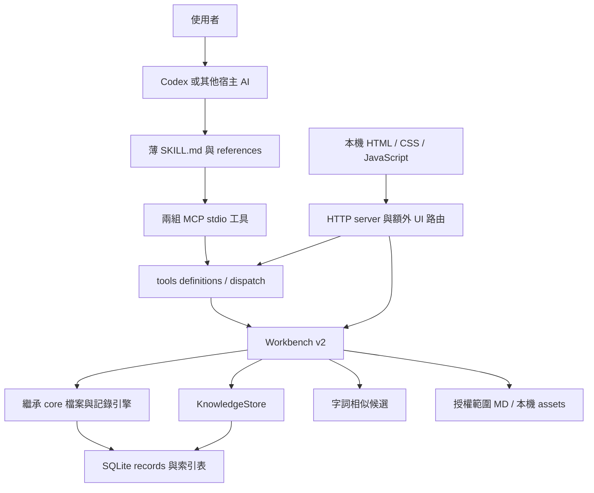

# 現況架構與差距

分析基準：本機 2.0.1、Git commit `30e1254`。本輪只讀原始碼與既有結果；沒有掃描使用者全部 MD、操作正式資料庫或重跑產品測試。先前的 43 項程式／MCP 測試與 31 項瀏覽器流程，是功能回歸證據，並不是 AI 能力提升評測。

## 現在的架構

資料庫已具備 WAL、交易、版本及旁註；文件有 metadata、章節 FTS5 trigram、引用圖及重疊範圍成員。核心紀錄仍大量存於通用 JSON records。UI 與 MCP 共用部分 dispatch，但還有 UI 專屬資料路徑。每個 MCP 程序可自行建立服務、監看及工作佇列，並沒有完整單一服務生命週期。

## Skill 本身的評估

| Skill | 現況 | 下一階段建議 |
|---|---|---|
| MD 管理台 | description 已說明做什麼及何時用；入口有路由、audit／changes 附件，方向正確 | description 收斂為「盤點、審核與維護指定範圍的 Markdown；用於指令檢查、內容整合、改名與待刪除標記。」避免讓一般任務都觸發盤點 |
| 理解工作台 | 入口短，按需求／經驗分附件；有範圍、版本、候選與已確認之分 | description 收斂為「整理本次需求並取用適用經驗；用於需求修正、知識重用、視覺實作與成果驗證。」長期整理走獨立維護路由 |
| 兩者交界 | 都能讀文件脈絡、操作範圍；一般使用者容易不清楚資料該存哪裡 | 原始檔案改寫只由 MD 變更服務負責；知識卡由理解工作台維護，以來源關聯連接。保留兩個入口，不重複兩套資料庫 |

不建議將目前只有十餘行的附件繼續機械式拆小。新增視覺、維護及評測能力後，再按「不同任務是否需要讀它」拆分附件；入口保留觸發條件與必要安全條件。

## 以原始碼確認的差距

下列代碼位置可對照 [已發布來源](https://github.com/Tosta10/MD/tree/30e1254ed4a6174903c72ff0ead6ac2e85e12df7)。每項均為設計依據，不表示本輪已修正。

| ID | 現況證據 | 影響 | 優先 |
|---|---|---|---|
| A01 | `src/core.mjs:171` 的五原則 audit 主要用字數、行數、正規表達式 | 可找候選，但不能可靠判斷流程邊界、授權例外或語意矛盾 | P1 |
| A02 | `src/workbench.mjs:119` 快取失效後仍全量 audit；相似分析載入文件集 | 列表已快，不代表重新分析同樣具備增量性能 | P0 |
| A03 | `src/knowledge.mjs:61` 搜尋用 LIKE、先 `ORDER BY title LIMIT 120` 再相關度排序 | 超過候選池時，標題較後的高相關知識可能被漏掉；中文整句與同義詞召回弱 | P0 |
| A04 | `src/knowledge.mjs:69–76` 適用欄位採精確比對；只要有 notWhen 就進 uncertain | 比胡亂套用安全，但大量正常例外可能使有用知識永遠不能直接採用；版本區間與關係無法表達 | P1 |
| A05 | `src/knowledge.mjs:82` runId 可省略；`find_context`、文件詳讀、圖片與大部分管理輸出沒有共同帳本 | 48KiB 不是整個插件或宿主的總用量上限 | P0 |
| A06 | ledger 以查詢內容或片段 ID 去重，搜尋 key 不含索引世代 | 同次執行內來源更新後，可能只回 alreadySent；須綁 snapshot/version 並明示失效 | P0 |
| A07 | `src/mcp.mjs:24` 指定圖片直接回傳原圖；`core.mjs:379` 主要驗格式與 8MiB 大小 | 沒有尺寸、區域、影像預算、可檢索描述或逐幀動態模型 | P0 預算；P1／P2 結構與動態 |
| A08 | `src/tools.mjs` 有視覺讀取及領域讀取，新增圖、領域編輯、合併 coverage 主要在 HTTP routes | AI 能力不及 UI；「一切可由 AI 使用」尚未達成 | P0 |
| A09 | `src/knowledge.mjs:110` 回報根據已填證據，baseline／heldOut 為 not_measured | 無獨立重現、資料隔離與品質提升證據，不能宣稱顯著變強 | P0 |
| A10 | `src/server.mjs:44` coverage 驗證已提供項目，但未在此路徑要求來源集合完整相等；變更套用也未統一強制 coverage | 有介面表單不等於所有 API 路徑都保證獨有內容被處理 | P0 |
| A11 | `public/app-v2.js:155` 標註與分類依序呼叫兩次服務 | 第二次失敗可能留下前一次結果，需回報部分完成或改為單一交易 | P0 |
| A12 | 文件分頁已完善；knowledge／findings 仍偏向單向 cursor；history 只列最近 30 批 | 各工作區操作不一致，長期管理很難找回舊批次 | P0 |
| A13 | `render()` 重新設定整個 app.innerHTML；草稿 Map 只在頁面記憶體 | 焦點、選取與捲動可能跳動；重新整理後沒有可靠草稿恢復 | P0 |
| A14 | UI 的表單、頁面、事件、API 邏輯集中在單一檔案，部分函式壓成長行 | 模組邊界與測試定位困難，持續增加功能會放大修改風險 | P1 |
| A15 | 視覺列表只展示前 30 圖、20 比較；圖片物件 URL 快取無清除策略 | 資產增加後找不到舊內容，也缺可控生命週期 | P1 |
| A16 | `DatabaseSync` 與多個程序共用 DB；監看屬程序記憶體；CPU 解析與 audit 未移至 worker | 工作較大時可能影響回應；服務重啟不會完整接續工作 | P1 |
| A17 | `readOnlyHint` 與 `destructiveHint` 依同一 write flag 分配 | 索引、草稿等寫入動作也標成 destructive；提示不足以表達實際副作用，應逐工具描述且仍由後端授權 | P0 |
| A18 | 現有 validated 需證據文字，但證據可為使用者／AI 填報 | 「有文字依據」與「被獨立執行器核對」需要不同證據等級 | P0 |

重點保留：原始 MD 不因標註而改寫、SHA 核對、版本衝突停止、失敗補償、回收還原、失效知識降級。這些是新版可依賴的基礎，無須為了換架構全部重做。

## 對 AI 的實質作用與限制

| 現有機制 | 可以改善的事 | 目前不能據此推論 |
|---|---|---|
| 目的、限制與驗收紀錄 | 減少遺漏及前後需求錯置 | 模型本身理解力永久增加 |
| 有範圍的經驗檢索 | 減少重複說明、重犯已知錯誤 | 每次一定找到正確經驗 |
| 來源版本與 evidence | 讓主張可追溯，避免舊結果自動沿用 | 主張因已儲存就變正確 |
| 視覺圖片與比較 | 讓偏好有具體參考 | 已理解動畫、渲染原理或能準確重現 |
| 工具及變更驗證 | 讓檔案維護更可控 | 其他宿主一定會自動使用該 skill |

合理的核心假說是：**在適當時機提供更準確、少量且可操作的證據，再用可重現回饋修正方案，會改善任務成果。** 是否顯著成立，依 07 的對照評測決定。

## 本輪取得的量測與邊界

純粹序列化工具定義，沒有呼叫資料庫：MD 23 支工具／12,251 UTF-8 bytes；理解 27 支／21,090 bytes；合併去重後 45 支／31,434 bytes。若宿主分別載入兩個插件，共用定義可能仍重複。bytes 不等於 token，也不表示每次都全量計費；由宿主實際工具載入與 tokenizer 決定。

既有一萬份文件量測：冷索引約 99 秒、暖掃描約 2.2 秒且正文重讀 0。它量的是本機索引，不能替代中文檢索品質、UI 使用者測試、AI 成果與成本評測。
